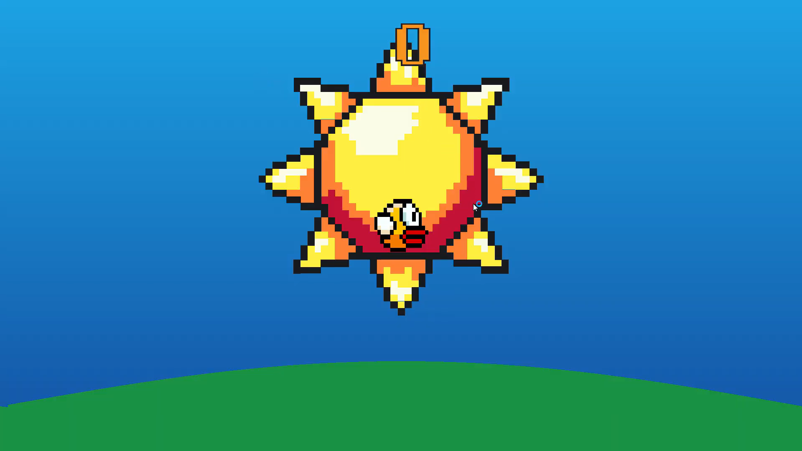
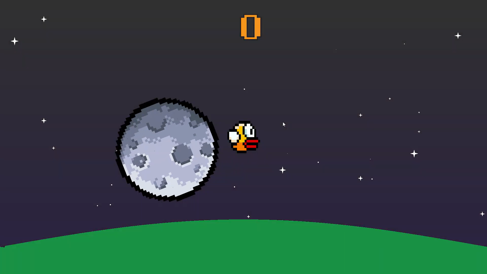
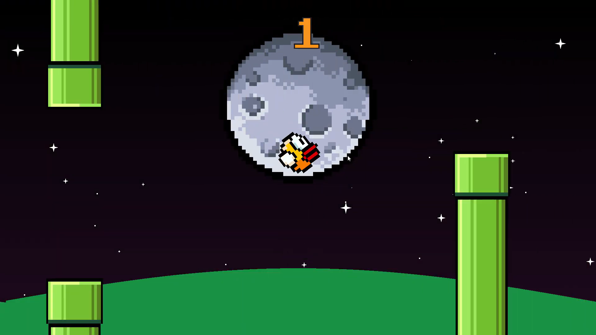

# 🐤 Flappy Bird (OpenGL)

---

## 🧩 Overview
This is a **Flappy Bird** game made purely using **OpenGL**, a very low-level graphics framework that renders pixels through vectors.  
It was developed during our **junior year** by a team of four:

- **Raiu (Raphael Paragua)**  
- **SaltinStillWaters (Mychal Pejana)**  
- **MJadeTC (Marnel Carpio)**  
- **Rolfdood (Ralph Bello)**  

The project focuses on implementing **real-time rendering**, **collision detection**, and **smooth animation** using **raw OpenGL functions** without any game engine support.

---

## 🖼️ Preview

  
  
  

---

## 🧑‍💻 Developers
- **Raiu (Raphael Paragua)**  
- **SaltinStillWaters (Mychal Pejana)**  
- **MJadeTC (Marnel Carpio)**  
- **Rolfdood (Ralph Bello)**  

---

## 🛠️ Technologies Used
- **Language:** C++  
- **Framework:** OpenGL  
- **Rendering:** Low-Level Vector Graphics  

---
